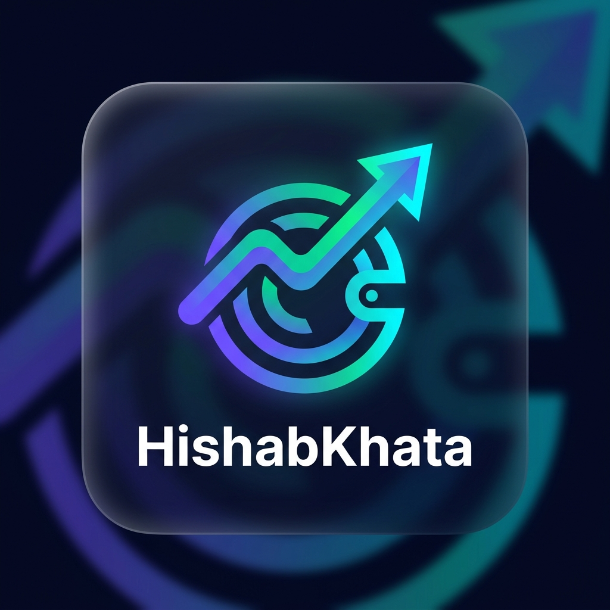

<p align="center">
  
</p>

# 💸 হিসাবখাতা — Smart Expense & Budget Tracker

একটি আধুনিক, দৃষ্টিনন্দন এবং ব্যবহারকারী-বান্ধব **ব্যক্তিগত বাজেট ও খরচ ট্র্যাকার (Personal Expense & Budget Tracker)** ওয়েব অ্যাপ্লিকেশন। ইন্টারনেট ছাড়াই পুরোপুরি অফলাইনে ব্রাউজারে চলবে এবং ব্যবহারকারীর ডেটা ডিভাইসের `LocalStorage`-এ সুরক্ষিত থাকবে।

---

## ✨ প্রধান ফিচারসমূহ (Key Features)

- 📊 **স্মার্ট ড্যাশবোর্ড (Financial Overview):**
  - মোট আয় (Total Income), মোট ব্যয় (Total Expense), এবং বর্তমান নিট ব্যালেন্স (Net Balance)।
  - মাসিক সঞ্চয়ের হার (%) ক্যালকুলেশন।
- 🎯 **মাসিক বাজেট প্রগ্রেস বার (Budget Tracker):**
  - কাস্টম বাজেট লিমিট নির্ধারণের সুবিধা।
  - লাইভ প্রগ্রেস বার এবং বাজেট অতিক্রম করলে বা ৮০% ছাড়ালে তাৎক্ষণিক সতর্কবার্তা (Alert Banner)।
- 📈 **ভিজ্যুয়াল অ্যানালিটিক্স (Chart.js Integration):**
  - ক্যাটাগরি অনুযায়ী খরচের ইন্টারঅ্যাক্টিভ ডোনাট/পাই চার্ট (মাঝখানে মোট খরচের হিসাবসহ)।
  - বিগত ৬ মাসের আয় বনাম খরচের ট্রেন্ড বার-চার্ট।
- ➕ **লেনদেন ব্যবস্থাপনা (CRUD Operations):**
  - আয় ও ব্যয়ের জন্য আলাদা ক্যাটাগরি, আইকন এবং পেমেন্ট মাধ্যম (নগদ, বিকাশ, নগদ, ব্যাংক, কার্ড)।
  - কুইক অ্যামাউন্ট চিপস (+১০০, +৫০০, +১০০০, +৫০০০) দিয়ে দ্রুত ইনপুট।
  - প্রতিটি লেনদেন পরবর্তী সময়ে এডিট ও ডিলিট করার সুবিধা।
- 🔍 **সার্চ ও ফিল্টারিং:**
  - যেকোনো কীওয়ার্ড বা নোট দিয়ে তাৎক্ষণিক ফিল্টার।
  - সময়সীমা (চলতি মাস, বিগত মাস, চলতি বছর, সব সময়) অনুযায়ী ফিল্টারিং।
- 📥 **CSV এক্সপোর্ট:**
  - এক্সেল-বান্ধব UTF-8 ফরম্যাটে এক ক্লিকে সম্পূর্ণ হিসাব ডাউনলোড।
- 🌓 **ডার্ক ও লাইট মোড:**
  - প্রিমিয়াম গ্লাস-মরফিজম (Glassmorphism) ডিজাইন এবং ডার্ক/লাইট থিম টগল।
- 💱 **মাল্টি-কারেন্সি সাপোর্ট:**
  - টাকা (৳ BDT), ডলার ($ USD), ইউরো (€ EUR), রুপি (₹ INR) নির্বাচন করার সুবিধা।

---

## 🛠️ প্রযুক্তিগত কাঠামো (Tech Stack)

- **Frontend:** Semantic HTML5
- **Styling:** Modern Vanilla CSS (Custom Design System, CSS Variables, Glassmorphism)
- **Logic & Storage:** Modern Vanilla JavaScript (ES6+), LocalStorage
- **Charts:** [Chart.js](https://www.chartjs.org/)
- **Typography:** Google Fonts (Outfit & Hind Siliguri)

---

## 🚀 লোকালি যেভাবে চালাবেন

১. রিপোজিটরিটি ক্লোন করুন:
```bash
git clone https://github.com/shahincse98/expense-budget-tracker.git
cd expense-budget-tracker
```

২. সরাসরি ব্রাউজারে `index.html` ফাইলটি ওপেন করুন অথবা যেকোনো লোকাল সার্ভার চালান:
```bash
python3 -m http.server 5000
```
তারপর ব্রাউজারে ভিজিট করুন: [http://localhost:5000](http://localhost:5000)

---

## 📄 লাইসেন্স
MIT License © 2026
